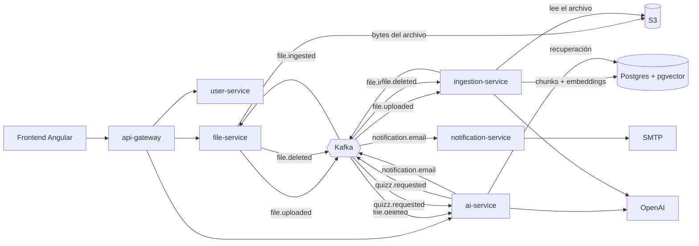

# LeAIrning

🇬🇧 [Read in English](README.md)

Sube tus documentos de estudio, hazles preguntas y conviértelos en quizzes. Construido con Java, Spring Boot y Spring AI como un conjunto de servicios pequeños alrededor de Kafka y Postgres.

- **Documentos:** sube archivos PDF o Markdown. Se indexan en segundo plano.
- **Chat:** pregunta sobre uno o varios documentos; las respuestas llegan en streaming e incluyen las fuentes de las que salen.
- **Quizzes:** genera quizzes de opción múltiple a partir de un documento (número de preguntas, opciones y dificultad), contéstalos y obtén la corrección desde el servidor. Recibes un email cuando el quizz está listo.

## Arquitectura



| Servicio | Puerto | Responsabilidad |
|---|---|---|
| `frontend` | 5173 | Aplicación Angular, servida con nginx |
| `api-gateway` | 8080 | Punto de entrada único, enrutado, CORS y validación del JWT |
| `user-service` | 8086 | Registro, login y refresco de sesión, perfil y avatar |
| `file-service` | 8082 | Subida, listado y borrado de archivos; estado del archivo |
| `ingestion-service` | 8083 | Extracción de texto, chunking y embeddings en pgvector |
| `ai-service` | 8081 | Chat RAG (con memoria) y quizzes |
| `notification-service` | 8084 | Envía los emails solicitados por Kafka |

Con Docker solo se publican el gateway y el frontend.

## Ejecutarlo

Necesitas Docker y una clave de API de OpenAI.

```bash
cp .env.example .env   # después pon tu OPENAI_API_KEY en .env
```

```bash
docker compose up --build
```

La primera construcción descarga dependencias y tarda unos minutos. Cuando se estabiliza:

| Qué | URL |
|---|---|
| La aplicación | http://localhost:5173 |
| API (a través del gateway) | http://localhost:8080/api/v1 |
| Grafana (trazas, métricas) | http://localhost:3000 (`admin` / `admin`) |
| Mailpit (emails que envía la app) | http://localhost:8025 |
| Kafka UI | http://localhost:8085 |
| Consola de S3 | http://localhost:9001 (`rustfsadmin` / `rustfsadmin`) |

Regístrate en la aplicación, sube un PDF o un Markdown, espera a que esté `READY` y luego chatea con él o genera un quizz. Todo el conjunto necesita unos 6 GiB de memoria.

## Desarrollar desde el IDE

Levanta solo la infraestructura y ejecuta los servicios tú mismo:

```bash
docker compose up -d postgres kafka s3 mailpit grafana
```

Cada servicio tiene su `application.yaml` con valores por defecto en `localhost`, así que arranca tal cual. Lanza `ai-service` e `ingestion-service` con `OPENAI_API_KEY` definida. El frontend se ejecuta con `pnpm install && pnpm start` dentro de `frontend/` (puerto 5173).

## Tests

Los tests del backend usan Testcontainers, así que Docker debe estar en marcha:

```bash
cd ai-service && ./mvnw verify   # igual en el resto de servicios
```

```bash
cd frontend && pnpm test
```

Cada servicio de backend tiene su propio workflow de GitHub Actions.

## Stack

Java 27, Spring Boot, Spring AI, Spring Cloud Gateway, Spring Kafka, Postgres con pgvector, Flyway, almacenamiento compatible con S3 (RustFS), Angular, Tailwind, OpenTelemetry con Grafana LGTM.

## Decisiones de diseño

Las versiones originales de los ADRs están en inglés; aquí tienes la traducción.

- [ADR 0001: Kafka para los flujos asíncronos](docs/adr/es/0001-kafka-para-flujos-asincronos.md)
- [ADR 0002: pgvector en el mismo Postgres](docs/adr/es/0002-pgvector-en-el-mismo-postgres.md)
- [ADR 0003: Los quizzes viven en ai-service](docs/adr/es/0003-quizzes-en-ai-service.md)

## Estado

Trabajo en curso. Los servicios dependen de un snapshot de Spring Boot, así que la primera construcción necesita acceso de red a `repo.spring.io`. La calidad de la recuperación y de las respuestas aún no se mide, y los ADRs recogen los huecos de fiabilidad conocidos.

## Licencia

[Apache 2.0](LICENSE)
