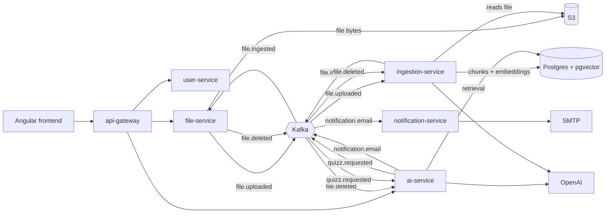

# LeAIrning

🇪🇸 [Leer en español](README.es.md)

Upload your study documents, ask questions about them and turn them into quizzes. Built with Java, Spring Boot and Spring AI as a set of small services around Kafka and Postgres.

- **Documents:** upload PDF or Markdown files. They are indexed in the background.
- **Chat:** ask questions about one or more documents; answers stream in and come with the sources they were drawn from.
- **Quizzes:** generate multiple-choice quizzes from a document (number of questions, options and difficulty), take them, and get graded on the server. You get an email when a quizz is ready.

## Architecture



| Service | Port | Responsibility |
|---|---|---|
| `frontend` | 5173 | Angular app, served by nginx |
| `api-gateway` | 8080 | Single entry point, routing, CORS and JWT validation |
| `user-service` | 8086 | Registration, login and refresh, profile and avatar |
| `file-service` | 8082 | Upload, listing and deletion of files; file status |
| `ingestion-service` | 8083 | Text extraction, chunking and embedding into pgvector |
| `ai-service` | 8081 | RAG chat (with memory) and quizzes |
| `notification-service` | 8084 | Sends emails requested through Kafka |

Only the gateway and the frontend are published when you run everything with Docker.

## Run it

You need Docker and an OpenAI API key.

```bash
cp .env.example .env   # then put your OPENAI_API_KEY in .env
```

```bash
docker compose up --build
```

The first build downloads dependencies and takes a few minutes. When it settles:

| What | URL |
|---|---|
| The app | http://localhost:5173 |
| API (through the gateway) | http://localhost:8080/api/v1 |
| Grafana (traces, metrics) | http://localhost:3000 (`admin` / `admin`) |
| Mailpit (emails sent by the app) | http://localhost:8025 |
| Kafka UI | http://localhost:8085 |
| S3 console | http://localhost:9001 (`rustfsadmin` / `rustfsadmin`) |

Register a user in the app, upload a PDF or Markdown file, wait for it to be `READY`, then chat with it or generate a quizz. The full stack needs roughly 6 GiB of memory.

## Develop from your IDE

Start only the infrastructure and run the services yourself:

```bash
docker compose up -d postgres kafka s3 mailpit grafana
```

Each service has its own `application.yaml` with `localhost` defaults, so it runs as is. Start `ai-service` and `ingestion-service` with `OPENAI_API_KEY` set. The frontend runs with `pnpm install && pnpm start` inside `frontend/` (port 5173).

## Tests

Backend tests use Testcontainers, so Docker must be running:

```bash
cd ai-service && ./mvnw verify   # same for the other services
```

```bash
cd frontend && pnpm test
```

Each backend service has its own GitHub Actions workflow.

## Stack

Java 27, Spring Boot, Spring AI, Spring Cloud Gateway, Spring Kafka, Postgres with pgvector, Flyway, S3-compatible storage (RustFS), Angular, Tailwind, OpenTelemetry with Grafana LGTM.

## Design decisions

Spanish versions are in [docs/adr/es](docs/adr/es).

- [ADR 0001: Kafka for asynchronous flows](docs/adr/0001-kafka-for-asynchronous-flows.md)
- [ADR 0002: pgvector in the same Postgres](docs/adr/0002-pgvector-in-the-same-postgres.md)
- [ADR 0003: Quizzes live in ai-service](docs/adr/0003-quizzes-live-in-ai-service.md)

## Status

A work in progress. The services depend on a Spring Boot snapshot, so the first build needs network access to `repo.spring.io`. Retrieval and answer quality are not measured yet, and the ADRs list the known reliability gaps.

## License

[Apache 2.0](LICENSE)
